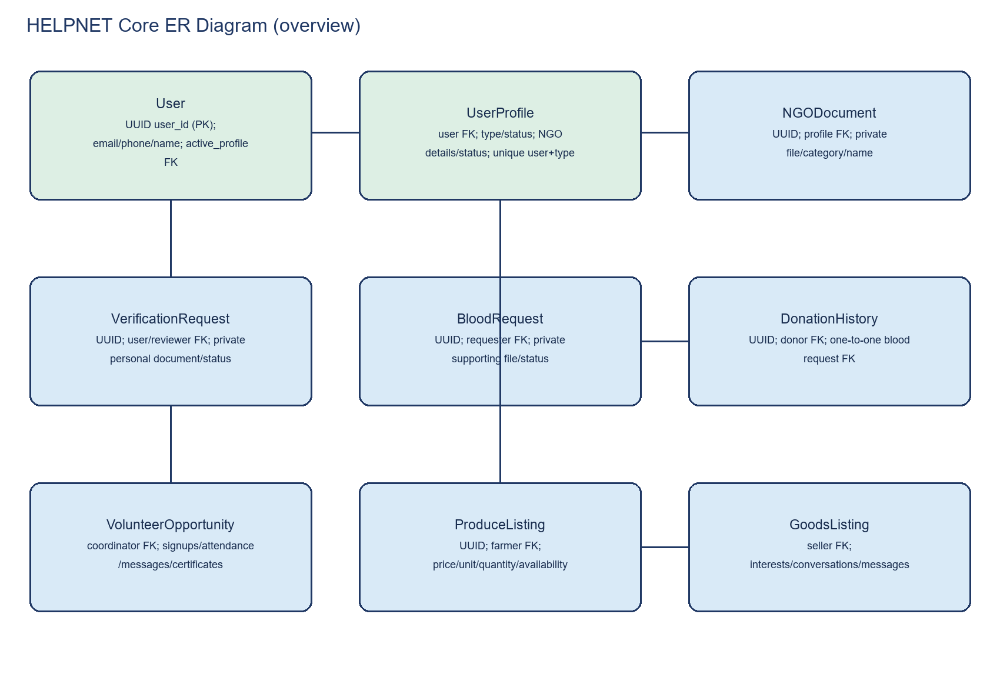

# HELPNET Database Documentation

**Date:** 2026-11-03. Django model/migration files under `backend/apps/*/migrations/` define the schema.

## Database engines

- Normal application settings select MySQL from environment variables. `.env` values are intentionally not included here.
- Automated tests select SQLite. The backend suite and migration-drift check used the test configuration.
- No production schema, dataset, or credential is reproduced.

## Entity inventory

| App | Models | Purpose / relationships |
|---|---|---|
| Users | `User`, `UserProfile`, `NGOVerificationDocument` | Custom UUID account; account-owned role profiles; organization files linked to NGO profile. |
| Identity verification | `VerificationRequest`, `AdminActionLog` | Personal document application/reviewer and protected admin-action history. |
| Blood | `DonorProfile`, `BloodRequest`, `DonationHistory` | One-to-one donor profile; requester-owned requests; one-to-one request/donation history. |
| Volunteer | `VolunteerProfile`, `VolunteerProfileDocument`, `VolunteerOpportunity`, `VolunteerSignup`, `VolunteerAttendance`, `VolunteerMessage`, `VolunteerCertificate` | Profiles, event coordinator, signups, attendance, messages, certificates, and private supporting documents. |
| Goods | `GoodsListing`, `GoodsInterest`, `GoodsConversation`, `GoodsMessage`, `GoodsReport` | Seller listings, expressions of interest, participant conversations/messages, and report model. |
| Health | `HealthQuestion`, `HealthReply`, `HealthProfessional` | Authored questions/replies and credential review. |
| Farmer | `ProduceListing` | Farmer-owned produce with price, unit, quantity, location, and availability. |
| Waste | `WasteCollector`, `WasteCollectorRating`, `WastePickupRequest` | Shared collectors, reviews, and pickup requests. |
| Ratings | `Rating` | User-to-user rating and comment. |
| Notifications | `Notification` | User-owned message, read state, and optional action URL. |
| Reports | `Report` | Generic content report and moderation target. |
| Common | None | Common app currently defines no database model. |

## Keys, relations, and constraints

- `User.user_id` is a UUID primary key; email and phone are unique. A legacy role remains for compatibility. Selected role workflows also use `active_profile`.
- `UserProfile.user` is a cascading FK. A unique constraint prevents duplicate profile types per account. `User.active_profile` is nullable and set null when that row is deleted.
- Profile API delete deactivates instead of deleting the account or role history. Dashboard offers deactivate/reactivate.
- NGO verification fields and timestamps live on `UserProfile`; `NGOVerificationDocument` has a UUID key, category, original filename, timestamp, and private file storage. Personal identity requests use separate `VerificationRequest` rows.
- `BloodRequest` has a UUID key and private supporting document. `DonationHistory.blood_request` is one-to-one and protected to retain history.
- Volunteer signup, attendance, and certificate models constrain duplicate event/user pairs. Volunteer supporting documents use private storage.
- Goods conversations are unique by listing/owner/interested user and prohibit the owner/interested user from being the same account.
- Ratings are unique per rater/rated-user pair; no interaction model currently scopes ratings to a transaction. Waste collector ratings are unique per collector/user pair.

## NGO and personal verification data

NGO status values are `not_submitted`, `pending`, `under_review`, `approved`, `rejected`, and `additional_documents_required`. Required fields include the organization name, registration number, address, contact email/phone, representative, and registration certificate. PDF/JPG/JPEG/PNG files are checked by extension, MIME, signature, and a 10 MiB limit. Other supporting files are optional unless requested during review. Personal NID/passport/birth-certificate workflow is separate; NGO approval does not mark personal verification approved.

## Relevant migrations

| Migration | Purpose |
|---|---|
| `users.0005_userprofile_active_profile` | Adds active profile selection. |
| `users.0006_userprofile_ngo_approval_status` | Adds legacy NGO approval state. |
| `users.0007_userprofile_ngo_address_and_more` | Adds organization fields, verification state/timestamps, and NGO private-document model/storage. |
| `blood.0003_bloodrequest_supporting_document` | Adds blood request attachment field. |
| `blood.0004_private_blood_request_documents` | Moves referenced blood request files to private storage. |
| `volunteer.0003_private_volunteer_certificates` | Adds private storage handling for volunteer profile documents. |

`makemigrations --check --dry-run` reported no drift. No migration was applied to live MySQL during this work.

## ER overview

This is an overview, not an exhaustive field-level schema; Django models and migrations are authoritative.
